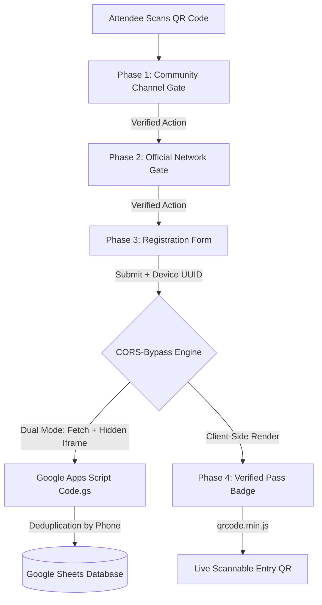

# QRGate: Access and Attendance Gateway

A decoupled, mobile-responsive access and attendance infrastructure built with blocky aesthetics, anti-proxy device fingerprinting, client-side QR badge generation, and a serverless Google Sheets backend.

---

## Architecture and Workflow



---

## Core Features

- **Decoupled Configuration:** Manage event titles, brand tags, theme colors, social gates, and form dropdowns directly in `config.js` without modifying core HTML or CSS files.
- **Anti-Proxy Smartphone Locking:** Automatically generates a unique device identifier (`dev_...`) stored in client storage and bound to the participant's phone number in Google Sheets, preventing proxy attendance across multiple phones.
- **Serverless Google Sheets Backend:** Uses Google Sheets as a database through a container-bound Google Apps Script that maps incoming columns and prevents duplicate registrations.
- **Cross-Browser CORS Bypass:** Implements a dual-submission pipeline using standard `no-cors` text requests with an invisible iframe fallback, ensuring compatibility across Safari, Chrome, Firefox, and in-app web views.
- **Dynamic Entry QR Pass:** Generates a client-side scannable entry QR badge upon form completion using `qrcode.min.js`.
- **4-Phase Stepper Controller:**
  1. **Phase 1 (Announcements):** Primary community/channel gate.
  2. **Phase 2 (Network):** Official network profile verification.
  3. **Phase 3 (Registration):** Participant details with input validation.
  4. **Phase 4 (Pass):** Confirmation screen with digital entry badge.

---

## Quickstart: How to Run Locally

QRGate is built using standard web technologies (HTML, CSS, JavaScript) and requires no build step or package installations.

### Option 1: Python
Run a local static file server using Python:
```bash
python -m http.server 8080
```
Open your browser and navigate to: `http://localhost:8080`

### Option 2: VS Code Live Server
1. Open this repository in Visual Studio Code.
2. Ensure the Live Server extension is installed.
3. Right-click `index.html` and select **Open with Live Server**.

### Option 3: Node.js / npx
```bash
npx serve .
```

### Option 4: Direct File Execution
You can also open `index.html` directly in any web browser by double-clicking the file.

---

## Google Sheets Backend Setup

### Step 1: Create a Google Sheet
1. Navigate to Google Sheets (sheets.new) and create a new blank spreadsheet.
2. Name the file (for example, "Event Attendance Database").

### Step 2: Add the Backend Script
1. In the Google Sheets menu, click **Extensions** -> **Apps Script**.
2. Remove any default code in `Code.gs`.
3. Open `backend/Code.gs` in this repository, copy the entire contents, and paste them into the Apps Script editor.
4. Save the project (Ctrl + S).

### Step 3: Initialize the Sheet
1. Select `setupSheet` from the function dropdown on the toolbar.
2. Click **Run**.
3. When prompted, complete the Google authorization flow:
   - Click **Review permissions** -> select your Google account.
   - Click **Advanced** -> click **Go to Untitled project (unsafe)** -> click **Allow**.
4. Switch back to your spreadsheet tab to confirm that column headers and formatting have been created.

### Step 4: Deploy as a Web App
1. In the upper-right corner of the Apps Script interface, click **Deploy** -> **New deployment**.
2. Click the gear icon (**Select type**) -> choose **Web app**.
3. Configure the settings:
   - **Description:** `Production v1`
   - **Execute as:** `Me (your email)`
   - **Who has access:** `Anyone` (Required to allow submissions from the web client)
4. Click **Deploy**.
5. Copy the generated **Web App URL** (format: `https://script.google.com/macros/s/.../exec`).

### Step 5: Configure the Frontend
Provide the Web App URL through either of these methods:
- Paste the URL into `config.js` under `defaultApiUrl`, or
- Click **Settings and Theme** in the website footer, paste the URL into the input field, and save.

---

## Configuration Reference (`config.js`)

All event settings are centralized in `config.js`:

### Branding
```javascript
branding: {
  appName: "YOUR EVENT NAME",
  tagline: "ORGANIZATION OR SUBTITLE",
  logoImage: null,  // Path to an image asset, or null to use monogram
  monogram: "QG",   // Two-character text mark
  footerText: "© Powered by QRGate Infrastructure • Open & Decoupled",
}
```

### Color Themes
Select an active theme from the predefined palettes:
```javascript
theme: {
  activeTheme: "obsidian-amber", // Options:
                                // - 'obsidian-amber'   (Dark navy base with amber accents)
                                // - 'cyber-cyan'       (Dark base with cyan accents)
                                // - 'emerald-tech'     (Dark base with emerald accents)
                                // - 'deep-monochrome'  (Neutral dark monochrome)
}
```

### Verification Gates (Phases 1 and 2)
```javascript
steps: {
  step1: {
    enabled: true,
    title: "Community Channel",
    subtitle: "Join our announcements channel to unlock the next step.",
    actionLabel: "JOIN COMMUNITY CHANNEL",
    url: "https://example.com/channel",
    handle: "@announcements"
  },
  step2: {
    enabled: true,
    title: "Official Network",
    subtitle: "Connect with our official profile to proceed.",
    actionLabel: "CONNECT ON NETWORK",
    url: "https://example.com/network",
    handle: "Official Page"
  }
}
```

### Form Fields and Categories (Phase 3)
```javascript
step3: {
  title: "Participant Details",
  categories: [
    "General Attendee",
    "Student / Researcher",
    "Developer / Builder",
    "VIP / Delegate",
    "Organizer / Staff"
  ],
  classes: [
    "Undergraduate (1st - 2nd Year)",
    "Undergraduate (3rd - 4th Year)",
    "Postgraduate / Masters",
    "Working Professional",
    "Other"
  ]
}
```

---

## Repository Structure

```text
QR-for-work/
├── config.js                 # Central configuration for branding, themes, and gates
├── index.html                # Semantic HTML infrastructure template
├── app.js                    # Application controller for state, storage, and sync
├── style.css                 # Theme tokens and blocky design system
├── qrcode.min.js             # Client-side QR code generator
├── backend/
│   ├── Code.gs               # Universal Google Apps Script backend
│   └── README.md             # Backend setup guide
├── archive/                  # Historical event archives
└── README.md                 # Project documentation
```

---

## Deployment to Production

### GitHub Pages
1. Commit and push your changes to GitHub:
   ```bash
   git add .
   git commit -m "Deploy QRGate portal"
   git push origin main
   ```
2. Navigate to your repository settings on GitHub:
   - Go to **Settings** -> **Pages**.
   - Under **Build and deployment**, select `Deploy from a branch`.
   - Set the branch to `main` and folder to `/(root)`.
   - Click **Save**.
3. The site will be available at your GitHub Pages URL within two minutes.

### Other Static Hosting Providers
Because the frontend consists entirely of static assets, it can also be hosted on platforms such as Cloudflare Pages, Netlify, or Vercel by pointing the deployment to the repository root with no build command required.

---

## Frequently Asked Questions

### Why does network submission use no-cors mode?
Google Apps Script redirects (HTTP 302) are rejected by standard browser CORS preflight checks. QRGate sends a `text/plain` payload using `mode: 'no-cors'` and maintains an invisible iframe fallback to ensure reliable submission across strict mobile browsers and in-app web views.

### How does Anti-Proxy Device Locking operate?
On first access, QRGate generates a unique device identifier (`dev_...`) stored locally in client storage. During registration, the participant's phone number is associated with this device ID in Google Sheets. If another user attempts to submit attendance using the same phone number from a different device, the request is flagged as a device mismatch.

### How can test registrations be reset on a device?
Open the **Settings and Theme** modal in the page footer, or clear your browser's local storage for the domain via Developer Tools (Application -> Storage -> Clear site data).

---

## License
Open source for community events, institutional check-ins, and workshops.
